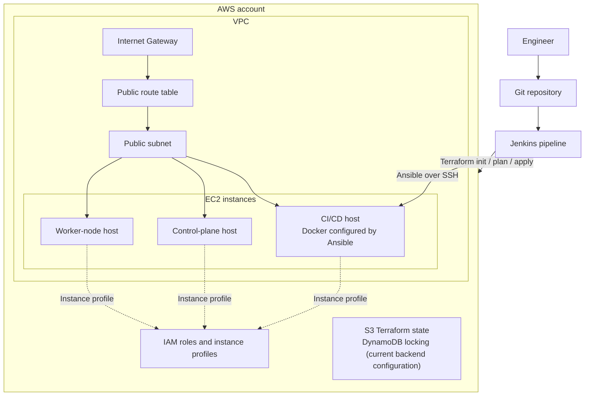

# AWS Infrastructure Automation with Terraform, Jenkins and Ansible

Provision AWS infrastructure with Terraform and configure an EC2-based CI/CD host with Ansible, orchestrated through a Jenkins pipeline.

This project demonstrates Infrastructure as Code (IaC), reusable Terraform modules, environment-specific configuration, remote state management, and automated host configuration.

> **Current scope:** The project provisions a CI/CD host, a control-plane host, and a worker-node host. It does **not** currently install or bootstrap a Kubernetes cluster on those hosts.

## Table of contents

- [Architecture](#architecture)
- [Features](#features)
- [Technology stack](#technology-stack)
- [Repository structure](#repository-structure)
- [Prerequisites](#prerequisites)
- [Configuration](#configuration)
- [Run Terraform locally](#run-terraform-locally)
- [Run through Jenkins](#run-through-jenkins)
- [Verification](#verification)
- [Disclaimer](#disclaimer)

## Architecture



The diagram reflects the current documented design. Review the actual security-group rules and instance settings before deploying it in an environment that is accessible from the internet.

## Features

- **Modular infrastructure:** Terraform modules for VPC networking, security groups, IAM roles and EC2 instances.
- **Environment configuration:** `dev` and `prod` variable files.
- **Remote state:** S3 backend with DynamoDB locking as currently configured in the repository.
- **Pipeline orchestration:** Jenkins selects the environment and runs Terraform and Ansible stages.
- **Configuration management:** Ansible installs Docker on the CI/CD host.
- **AWS access management:** IAM roles and instance profiles are defined for the EC2 host roles.
- **Infrastructure outputs:** Terraform exposes the CI/CD host public IP for the Ansible connection.

## Technology stack

| Technology | Purpose |
|---|---|
| AWS VPC, subnet, route table, internet gateway | Network foundation |
| Amazon EC2 | CI/CD, control-plane and worker-node hosts |
| AWS IAM | Instance roles, policies and instance profiles |
| Amazon S3 | Terraform remote state |
| Amazon DynamoDB | State locking in the current backend configuration |
| Terraform | Infrastructure provisioning and state management |
| Jenkins | Pipeline orchestration and environment selection |
| Ansible | Host configuration and Docker installation |
| Docker | Runs the Ansible execution image in the Jenkins pipeline |

## Repository structure

```text
.
├── ansible/
│   └── install-docker.yaml       # Installs Docker on the CI/CD host
├── env/
│   ├── dev.tfvars                # Development environment values
│   └── prod.tfvars               # Production environment values
├── modules/
│   ├── ec2/                      # EC2 instance definitions and AMI lookup
│   ├── iam_roles/                # IAM roles, policies and instance profiles
│   ├── sg/                       # Security groups
│   └── vpc/                      # VPC, subnet, gateway and routes
├── backend.tf                    # S3 backend and state-locking configuration
├── cloud-init.yaml               # Initial CI/CD host setup
├── Jenkinsfile                  # Terraform and Ansible pipeline
├── main.tf                       # Root module wiring
├── variables.tf                  # Root input variables
└── README.md
```

## Prerequisites

Before deploying, make sure you have:

- An AWS account with permissions to create the resources defined by the Terraform configuration.
- Terraform installed (the repository's version constraints are defined in `versions.tf`; use a compatible version).
- AWS CLI installed and configured if using local deployment.
- An existing EC2 key pair in the target AWS region.
- An existing S3 bucket for Terraform state and a DynamoDB table for locking, matching the current `backend.tf` configuration.
- For Jenkins deployment: a configured Jenkins agent, the required plugins, Docker available to run the Ansible image, and the credentials described below.
- SSH access from the Jenkins agent to the CI/CD EC2 host.

**Important:** Terraform backend resources must exist before `terraform init`. The backend block uses values configured in the repository; inspect `backend.tf` and supply your own resource names. Do not commit credentials, private keys, state files, or saved plan files.

## Configuration

### 1. Review environment variables

Update the relevant variable file:

- [`env/dev.tfvars`](env/dev.tfvars)
- [`env/prod.tfvars`](env/prod.tfvars)

Check the VPC CIDR, public subnet CIDR, environment name, availability zone, EC2 key-pair name, and any other required variables. The selected AWS region and availability zone must match.

The current Jenkins pipeline uses `ap-southeast-2`; update the pipeline and provider/backend settings together if you use another region.

### 2. Configure the remote backend

Review [`backend.tf`](backend.tf) and make sure the S3 bucket and DynamoDB table already exist and are in the intended region. Use separate state keys for each environment:

- Development: `envs/dev/terraform.tfstate`
- Production: `envs/prod/terraform.tfstate`

Protect the state bucket with appropriate IAM permissions, encryption, and S3 versioning. Terraform state can contain sensitive infrastructure data.

### 3. Configure Jenkins credentials

The Jenkinsfile expects these credential IDs:

| Jenkins credential ID | Purpose |
|---|---|
| `aws-jenkins-creds` | AWS authentication used by the pipeline |
| `ec2-ssh-key` | SSH private key used by Ansible to connect to the CI/CD host |

Configure credentials using the correct Jenkins credential types and verify that the AWS provider and AWS CLI receive the authentication values they expect. Never store credentials directly in the Jenkinsfile or commit private keys to Git.

Where feasible, prefer an EC2 instance role or another short-lived credential mechanism over long-lived AWS access keys.

## Run Terraform locally

Run commands from the Terraform root directory.

### 1. Initialize the backend

For development:

```bash
terraform init -input=false \
  -backend-config="region=ap-southeast-2" \
  -backend-config="key=envs/dev/terraform.tfstate"
```

For production, use `envs/prod/terraform.tfstate` as the key.

If you change backend settings, review whether `terraform init -reconfigure` or a state migration is appropriate. Do not migrate or overwrite state without understanding the effect.

### 2. Format and validate

```bash
terraform fmt -recursive -check
terraform validate
```

### 3. Review and apply the plan

```bash
terraform plan -var-file="env/dev.tfvars" -out="tfplan"
terraform apply "tfplan"
```

Review the plan before applying it. The saved plan may contain sensitive data; keep it out of Git and remove it securely after use.

To deploy production, use `env/prod.tfvars` and initialize with the production state key.

### 4. Read the CI/CD host public IP

```bash
terraform output -raw cicd_server_public_ip
```

## Run through Jenkins

The Jenkins pipeline provides an environment choice (`dev` or `prod`) and is intended to perform the following sequence:

1. Check out the repository.
2. Select the environment-specific variable file.
3. Initialize Terraform with the matching S3 state key.
4. Generate a Terraform plan and apply it.
5. Read `cicd_server_public_ip` and generate an Ansible inventory.
6. Run `ansible/install-docker.yaml` against the CI/CD host over SSH.
7. Clean up the Jenkins workspace.

Before running the job:

- Configure the Jenkins credentials listed above.
- Ensure the Jenkins agent has Docker and can reach the EC2 host over SSH.
- Confirm the selected environment, region, state key, and key-pair name.
- Review the plan and the resources that will be created or changed.
- Consider adding a mandatory approval gate for production before applying changes.

The current pipeline configuration should be reviewed for SSH host-key verification, credential handling, failure handling, and production approval before use beyond a disposable learning environment.

## Verification

After deployment, verify the results rather than relying only on a successful pipeline status.

Examples:

```bash
terraform output
aws ec2 describe-instances \
  --region ap-southeast-2 \
  --query "Reservations[].Instances[].[InstanceId,State.Name,PublicIpAddress]" \
  --output table
```

Confirm that:

- The expected EC2 instances are running.
- The CI/CD host is reachable through the intended SSH path.
- The Ansible playbook completes successfully.
- Docker is installed and available on the CI/CD host.
- The Terraform state is stored under the expected environment-specific key.

Only publish screenshots or logs after removing account identifiers, public IPs, credentials, private data, and other sensitive details.

---

## Disclaimer

This repository is intended for learning and portfolio demonstration. Review the Terraform configuration, IAM permissions, network exposure, backend settings, and Jenkins credentials before deploying it. Validate all changes in a disposable development environment before considering production use.
