# 🚀 AWS Infrastructure Automation — Terraform, Jenkins & Ansible

[](https://aws.amazon.com/)
[](https://developer.hashicorp.com/terraform)
[](https://www.jenkins.io/)
[](https://www.ansible.com/)
[](https://www.docker.com/)
[](https://github.com/)

A hands-on AWS DevOps portfolio project demonstrating **Infrastructure as Code (IaC)** with Terraform and automated host configuration with Ansible, orchestrated by Jenkins.

> 🎯 **Goal:** Provision a reusable AWS infrastructure foundation for development and production environments, then configure the CI/CD EC2 host automatically.

> ℹ️ **Current scope:** The project provisions a CI/CD host, a control-plane host, and a worker-node host. It does **not** currently install or bootstrap a Kubernetes cluster on those hosts.

---

## 📚 Table of Contents

- [✨ Project Overview](#-project-overview)
- [🏗️ Architecture](#architecture)
- [⚙️ Workflow](#-workflow)
- [🧰 Technology Stack](#-technology-stack)
- [📁 Repository Structure](#-repository-structure)
- [🛠️ Prerequisites](#prerequisites)
- [🔧 Configuration](#-configuration)
- [🔄 Run Through Jenkins](#-run-through-jenkins)
- [✅ Verification](#-verification)
- [🧹 Cleanup and Cost Management](#-cleanup-and-cost-management)
- [🎓 What This Project Demonstrates](#-what-this-project-demonstrates)

---

## ✨ Project Overview

This project uses Terraform modules to provision AWS infrastructure and a Jenkins pipeline to coordinate Terraform deployment and Ansible configuration.

### 🏗️ Infrastructure as Code

Terraform modules are used to define:

- 🌐 **Networking** — VPC, public subnet, internet gateway, and public route table.
- 🛡️ **Security groups** — separate rules for the different EC2 host roles.
- 🔑 **IAM** — roles, policies, and instance profiles.
- 🖥️ **EC2** — CI/CD, control-plane, and worker-node hosts.

### 🔧 Configuration management

After infrastructure provisioning, Jenkins obtains the CI/CD host's public IP, generates an Ansible inventory, and runs the Docker installation playbook against that host over SSH.

### 🌍 Environment separation

The repository includes separate `dev` and `prod` variable files and uses environment-specific Terraform state keys. These configurations support environment separation, but do not by themselves guarantee complete production isolation; review IAM permissions, backend access, and network boundaries before use.

---

## Architecture

```mermaid
flowchart TB
    DEV["👩‍💻 Engineer"] --> GIT["🐙 Git repository"]
    GIT --> JENKINS["🔧 Jenkins pipeline"]

    subgraph AWS["☁️ AWS account"]
      subgraph VPC["🌐 VPC"]
        IGW["🌍 Internet Gateway"]
        RT["🛣️ Public route table"]
        SUBNET["📡 Public subnet"]
        IGW --> RT --> SUBNET

        subgraph HOSTS["🖥️ EC2 instances"]
          CICD["🔧 CI/CD host<br/>Docker configured by Ansible"]
          CP["⚙️ Control-plane host"]
          WORKER["⚙️ Worker-node host"]
        end

        SUBNET --> CICD
        SUBNET --> CP
        SUBNET --> WORKER
      end

      IAM["🔑 IAM roles and instance profiles"]
      STATE["🗄️ S3 Terraform state<br/>DynamoDB locking"]
      CICD -. "Instance profile" .-> IAM
      CP -. "Instance profile" .-> IAM
      WORKER -. "Instance profile" .-> IAM
    end

    JENKINS -->|"Terraform init / plan / apply"| AWS
    JENKINS -->|"Ansible over SSH"| CICD
```



> ⚠️ The diagram reflects the documented design. Review the actual security-group rules, IAM policies, and instance network settings before deploying to an internet-accessible environment.

### 🔁 Workflow

1. 🐙 Jenkins checks out the repository.
2. 🌍 The selected environment determines the `.tfvars` file and Terraform state key.
3. 🧱 Terraform initializes, creates a plan, and applies infrastructure changes.
4. 📤 Terraform outputs the CI/CD host's public IP.
5. 📝 Jenkins generates an Ansible inventory.
6. 🔐 Ansible connects to the CI/CD host over SSH.
7. 🐳 Ansible installs Docker on the CI/CD host.
8. 🧹 Jenkins cleans up its workspace.

---

## 🧰 Technology Stack

| Technology | Purpose |
|---|---|
| ☁️ **AWS VPC** | Network foundation |
| 🖥️ **Amazon EC2** | CI/CD, control-plane, and worker-node hosts |
| 🔑 **AWS IAM** | Roles, policies, and instance profiles |
| 🗄️ **Amazon S3** | Terraform remote state |
| 🔒 **Amazon DynamoDB** | State locking in the current backend configuration |
| 🧱 **Terraform** | Infrastructure provisioning and state management |
| 🔧 **Jenkins** | Pipeline orchestration and environment selection |
| 🤖 **Ansible** | Host configuration and Docker installation |
| 🐳 **Docker** | Runs the Ansible execution image in the Jenkins pipeline |
| 🐙 **GitHub** | Source control and project collaboration |

---

## 📁 Repository Structure

```text
.
├── ansible/
│   └── install-docker.yaml       # Installs Docker on the CI/CD host
├── env/
│   ├── dev.tfvars                # Development environment values
│   └── prod.tfvars               # Production environment values
├── images/                       # Project execution screenshots
│   └── jenkins-pipeline-success.png
├── modules/
│   ├── ec2/                      # EC2 definitions and AMI lookup
│   ├── iam_roles/                # IAM roles, policies, and profiles
│   ├── sg/                       # Security groups
│   └── vpc/                      # VPC, subnet, gateway, and routes
├── backend.tf                    # S3 backend and state-locking configuration
├── cloud-init.yaml               # Initial CI/CD host setup
├── Jenkinsfile                   # Terraform and Ansible pipeline
├── main.tf                       # Root module wiring
├── variables.tf                  # Root input variables
├── versions.tf                   # Terraform and provider constraints
├── .gitignore                    # Files excluded from Git
└── README.md                     # Project documentation
```

> 📌 Keep this tree aligned with the actual repository if files or directories change.

---

## Prerequisites

### 💻 Local deployment

- AWS account and permissions to create the configured resources.
- Terraform version compatible with the constraints in `versions.tf`.
- AWS CLI configured with an appropriate profile or environment credentials.
- An existing EC2 key pair in the target AWS Region.
- An existing S3 bucket for Terraform state and DynamoDB table for locking, as required by the current backend configuration.

### 🔧 Jenkins deployment

- Jenkins controller and agent configured to run the pipeline.
- Docker available to run the Ansible execution image.
- Network connectivity from the Jenkins agent to the CI/CD EC2 host over SSH.
- Jenkins credentials configured with the IDs expected by the Jenkinsfile.

> ⚠️ Create and secure the backend resources **before** running `terraform init`. Do not commit AWS credentials, SSH private keys, Terraform state files, or saved plan files.

---

## 🔧 Configuration

### 1. 🌍 Configure the environment

Review the relevant variable file:

- [`env/dev.tfvars`](env/dev.tfvars)
- [`env/prod.tfvars`](env/prod.tfvars)

Check the VPC CIDR, subnet CIDR, environment name, availability zone, EC2 key-pair name, and other required values. Make sure the AWS Region matches the selected availability zone.

The current Jenkins pipeline uses `ap-southeast-2`. If you use another Region, update the provider, backend initialization, and pipeline settings consistently.

### 2. 🗄️ Configure Terraform remote state

Review [`backend.tf`](backend.tf) and ensure that the S3 bucket and DynamoDB table exist in the intended Region.

The pipeline uses separate state keys:

- 🧪 Development: `envs/dev/terraform.tfstate`
- 🚀 Production: `envs/prod/terraform.tfstate`

Protect the state bucket with appropriate IAM permissions, encryption, and S3 versioning. Terraform state can contain sensitive infrastructure data.

### 3. 🔐 Configure Jenkins credentials

The Jenkinsfile expects the following credential IDs:

| Credential ID | Purpose |
|---|---|
| `aws-jenkins-creds` | AWS authentication used by the pipeline |
| `ec2-ssh-key` | SSH private key used by Ansible to connect to the CI/CD host |

Configure each credential using the correct Jenkins credential type. Verify that Terraform and the AWS CLI receive the authentication values they expect. Never hardcode credentials in the Jenkinsfile or commit private keys.

Where feasible, prefer an EC2 instance role or another short-lived credential mechanism over long-lived AWS access keys.

---

## 🔄 Run Through Jenkins

The Jenkins pipeline provides an environment choice (`dev` or `prod`) and is intended to run these stages:

| Stage | Action |
|---|---|
| 🐙 Checkout | Check out the repository |
| 🌍 Environment | Select the matching variable file and state key |
| 🧱 Terraform init | Initialize the backend |
| 📝 Terraform plan | Generate the infrastructure plan |
| 🚀 Terraform apply | Apply the plan |
| 📤 Output | Read `cicd_server_public_ip` |
| 🤖 Ansible | Generate inventory and run `ansible/install-docker.yaml` over SSH |
| 🧹 Cleanup | Clean up the Jenkins workspace |

### ✅ Before running the pipeline

- Confirm the required Jenkins credentials are configured.
- Ensure the Jenkins agent has Docker and can reach the EC2 host over SSH.
- Verify the selected environment, Region, state key, and key-pair name.
- Review the Terraform plan and the resources that will be created or changed.
- Consider adding a mandatory approval gate for production.
- Review SSH host-key verification, credential handling, and failure handling before using the pipeline beyond a disposable learning environment.

### 📸 Jenkins Pipeline Execution

The screenshot below shows the Jenkins Pipeline Stage View after a
successful run. It provides a visual record of the pipeline stages and
their execution status.


---

## ✅ Verification

After deployment, verify the result rather than relying only on a successful pipeline status.

### Check Terraform outputs

```bash
terraform output
```

### Check EC2 instance status

```bash
aws ec2 describe-instances \
  --region ap-southeast-2 \
  --query "Reservations[].Instances[].[InstanceId,State.Name,PublicIpAddress]" \
  --output table
```

### Confirm the deployment

- ✅ Expected EC2 instances are running.
- ✅ The CI/CD host is reachable through the intended SSH path.
- ✅ The Ansible playbook completes successfully.
- ✅ Docker is installed and available on the CI/CD host.
- ✅ Terraform state is stored under the expected environment-specific key.

---

## 🧹 Cleanup and Cost Management

AWS resources may continue to incur charges while running. Destroy only the environment you intend to remove and confirm that the correct backend state key is selected.

### 🧪 Destroy development resources

```bash
terraform plan -destroy -var-file="env/dev.tfvars"
terraform destroy -var-file="env/dev.tfvars"
```

For production, use `env/prod.tfvars` only if you intentionally deployed that environment and have confirmed it is safe to destroy.

> ⚠️ The S3 state bucket and DynamoDB locking table may be managed separately. Do not delete backend resources while any environment still depends on them. After cleanup, check AWS Billing for any remaining billable resources.

---

## 🎓 What This Project Demonstrates

- 🧱 Infrastructure as Code using reusable Terraform modules.
- 🌐 AWS networking and EC2 provisioning.
- 🔑 IAM roles, policies, and instance profiles.
- 🗄️ Remote state management and environment-specific state keys.
- 🔄 Jenkins orchestration of infrastructure provisioning.
- 🤖 Ansible-based configuration management.
- 🐳 Docker usage for the Ansible execution environment.
- 🔐 Awareness of cloud security, credentials, and deployment safeguards.
- 🧹 Infrastructure cleanup and cost awareness.

---

## ⚠️ Disclaimer

This repository is intended for learning and portfolio demonstration. Review the Terraform configuration, IAM permissions, network exposure, backend settings, and Jenkins credentials before deploying it. Validate changes in a disposable development environment before considering production use.
